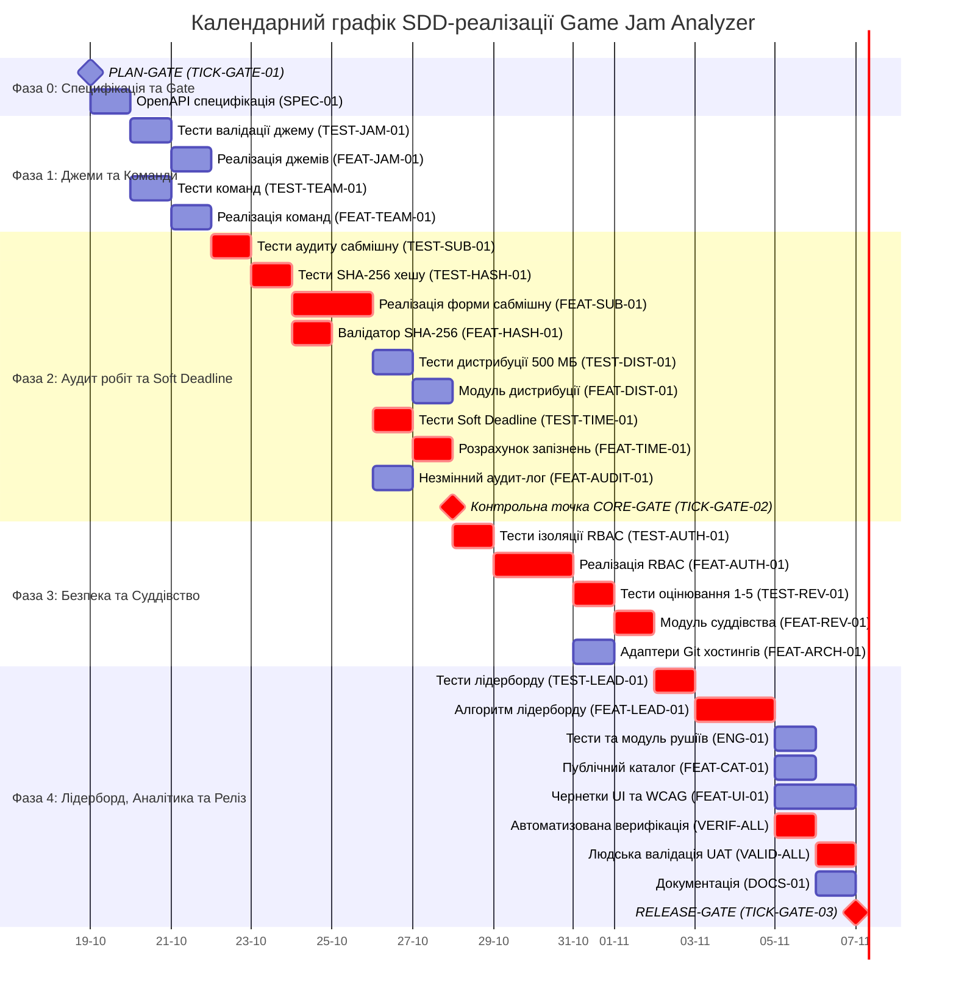

# Календарний план, діаграма Ганта та аналіз критичного шляху

- **Проєкт**: Інформаційна система обліку та аналізу ігрових джемів (Game Jam Analyzer)
- **Версія плану**: 1.0 (Етап PLAN-GATE)
- **Дата створення**: 2026-10-16
- **Методологія планування**: SDD (Specification-Driven Development) із застосуванням CPM (Critical Path Method)

---

## 1. Поетапний план реалізації (Фази / Спринти)

Проєкт структуровано на 5 логічних фаз із жорстким контролем залежностей:

### Фаза 0: Специфікація, архітектурний базис та PLAN-GATE (Тиждень 1, Дні 1–2)
- **Мета**: Валідація декомпозиції, формалізація схем даних та отримання схвалення PLAN-GATE.
- Задачі: `TICK-GATE-01` (PLAN-GATE), `TICK-SPEC-01` (OpenAPI специфікація).
- Результат: розблоковано виконання задач реалізації (Рішення GO).

### Фаза 1: Управління джемами, реєстрація команд та базова доменна модель (Тиждень 1, Дні 3–4)
- **Мета**: Створення функціоналу конфігурації джемів та формування команд учасників.
- Задачі: `TICK-TEST-JAM-01`, `TICK-FEAT-JAM-01`, `TICK-TEST-TEAM-01`, `TICK-FEAT-TEAM-01`.
- Результат: робочі модулі `src/jams` та `src/teams`, покриті тестами на 100%.

### Фаза 2: Прийом робіт, криптографічний аудит SHA-256, дистрибуція та Soft Deadline (Тиждень 2, Дні 5–8)
- **Мета**: Реалізація найкритичнішого бізнес-ядра системи (подання робіт, фіксація хешів, облік запізнень).
- Задачі: `TICK-TEST-SUB-01`, `TICK-TEST-HASH-01`, `TICK-FEAT-SUB-01`, `TICK-FEAT-HASH-01`, `TICK-TEST-DIST-01`, `TICK-FEAT-DIST-01`, `TICK-TEST-TIME-01`, `TICK-FEAT-TIME-01`, `TICK-FEAT-AUDIT-01`, `TICK-GATE-02` (CORE-GATE).
- Результат: пройдено проміжну точку якості CORE-GATE, перевірено незмінність хешів та алгоритм штрафів.

### Фаза 3: Безпека закритого суддівства (RBAC), оцінювання журі та адаптери (Тиждень 3, Дні 9–11)
- **Мета**: Ізоляція оцінок на етапі Under Review та надання інтерфейсу суддівства за 5 критеріями.
- Задачі: `TICK-TEST-AUTH-01`, `TICK-FEAT-AUTH-01`, `TICK-TEST-REV-01`, `TICK-FEAT-REV-01`, `TICK-FEAT-ARCH-01`.
- Результат: захищений бекенд із розмежуванням ролей та збереженням оцінок у транзакційному сховищі.

### Фаза 4: Лідерборд, аналітика рушіїв, публічний каталог, валідація та RELEASE-GATE (Тиждень 3–4, Дні 12–15)
- **Мета**: Побудова детермінованого рейтингу, аналітичних звітів, фронтенд-чернеток та здача релізу.
- Задачі: `TICK-TEST-LEAD-01`, `TICK-FEAT-LEAD-01`, `TICK-TEST-ENG-01`, `TICK-FEAT-ENG-01`, `TICK-FEAT-CAT-01`, `TICK-FEAT-UI-01`, `TICK-VERIF-ALL-01`, `TICK-VALID-ALL-01`, `TICK-DOCS-01`, `TICK-GATE-03` (RELEASE-GATE).
- Результат: готова перевірена система, пройдено RELEASE-GATE.

---

## 2. Діаграма Ганта (Gantt Chart)

Нижче наведено календарний графік робіт у форматі Mermaid:

---

## 3. Аналіз критичного шляху (Critical Path Method - CPM)

Критичний шлях визначає найдовшу послідовність взаємозалежних задач, затримка будь-якої з яких безпосередньо призводить до зміщення фінального терміну завершення проєкту.

### 3.1. Ланцюжок критичного шляху (Critical Path):
$$\text{PLAN-GATE} \rightarrow \text{TICK-SPEC-01} \rightarrow \text{TICK-TEST-JAM-01} \rightarrow \text{TICK-FEAT-JAM-01} \rightarrow \text{TICK-TEST-SUB-01} \rightarrow \text{TICK-TEST-HASH-01} \rightarrow \text{TICK-FEAT-SUB-01} \rightarrow \text{TICK-TEST-TIME-01} \rightarrow \text{TICK-FEAT-TIME-01} \rightarrow \text{CORE-GATE} \rightarrow \text{TICK-TEST-AUTH-01} \rightarrow \text{TICK-FEAT-AUTH-01} \rightarrow \text{TICK-TEST-REV-01} \rightarrow \text{TICK-FEAT-REV-01} \rightarrow \text{TICK-TEST-LEAD-01} \rightarrow \text{TICK-FEAT-LEAD-01} \rightarrow \text{TICK-VERIF-ALL-01} \rightarrow \text{TICK-VALID-ALL-01} \rightarrow \text{RELEASE-GATE}$$

- **Сумарна критична тривалість**: **42.5 робочих годин** (орієнтовно 9–10 календарних робочих днів при активному навантаженні).

### 3.2. Резерви часу некритичних задач (Slack / Float Analysis):
Задачі, що не лежать на критичному шляху, мають часовий буфер (Slack), протягом якого їхнє виконання може бути відкладене без затримки всього проєкту:

| Задача | Призначення | Загальний резерв часу (Total Float) | Вплив на критичний шлях |
|---|---|---|---|
| `TICK-FEAT-TEAM-01` | Реєстрація команд та інвайтів | **3 дні** | Виконується паралельно з валідацією джемів, не блокує сабмішн до фази тестування. |
| `TICK-FEAT-DIST-01` | Валідація ваги білда 500 МБ | **2 дні** | Не блокує розрахунок м'якого дедлайну; потрібна лише до CORE-GATE. |
| `TICK-FEAT-AUDIT-01` | Незмінний журнал аудиту змін | **2 дні** | Накопичує події фоново; необхідна до CORE-GATE. |
| `TICK-FEAT-ARCH-01` | Патерн Адаптер для Git | **4 дні** | Архітектурна ізоляція зовнішніх API; не впливає на бізнес-розрахунок лідерборду. |
| `TICK-FEAT-ENG-01` | Аналітика ігрових рушіїв | **3 дні** | Читає готові сабмішни, виконується паралельно з підготовкою релізу. |
| `TICK-FEAT-CAT-01` | Публічний каталог ігор | **3 дні** | Візуальне представлення; не блокує верифікацію математики лідерборду. |
| `TICK-FEAT-UI-01` | Локальні чернетки форм та WCAG | **2 дні** | Покращення клієнтського UX, не впливає на бекенд-валідацію. |

---

## 4. Аналіз тривалості людських дій (Human Bottleneck Analysis)

У конвеєрі SDD кодинговий агент (LLM) генерує фрагменти коду або тести за лічені хвилини. Проте **загальний календарний темп проєкту лімітується людиною**.

### Чому людина є «вузьким місцем» (Bottleneck):
1. **Когнітивне занурення та аналіз контексту**: людині потрібно від 30 до 60 хвилин на вичитку та осмислення згенерованих сутностей, виявлення прихованих сайд-ефектів та нетривіальних крайових умов.
2. **Верифікація та рішення Stage-Gate**: кожна контрольна точка (`PLAN-GATE`, `CORE-GATE`, `RELEASE-GATE`) вимагає ручного проходження чекліста, перевірки відповідності SRS та фіксації персональної відповідальності. Час прийняття рішення Gate коливається від 1.5 до 3 годин.
3. **Валідація бізнес-задуму (UAT/UX)**: перевірка зручності інтерфейсу, ергономіки заповнення форм подання гри капітаном та карток оцінювання журі не може бути автоматизована і потребує щонайменше 3–4 годин уважної експертної роботи.
4. **Запобігання Automation Bias**: ризик формального «штампування» PR (Rubber-stamping) змушує свідомо сповільнювати рев'ю для запобігання пропуску критичних дефектів у ядрі аудиту (наприклад, некоректна регулярка SHA-256).

> **Висновок**: календарне планування проєкту повинно враховувати пропускну здатність людського контролю, резервуючи щонайменше 35–40% загального фонду часу саме на дії людини (Review, Validation, Gate).
